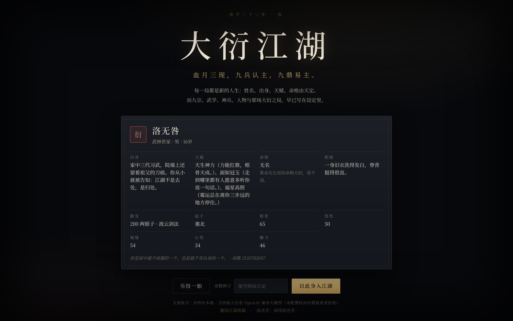
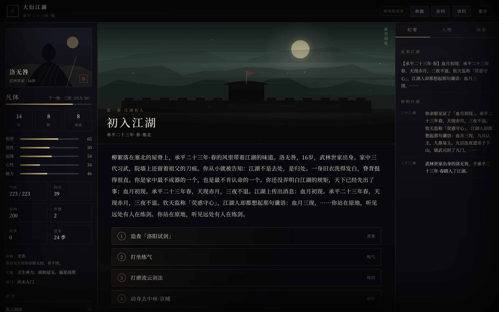
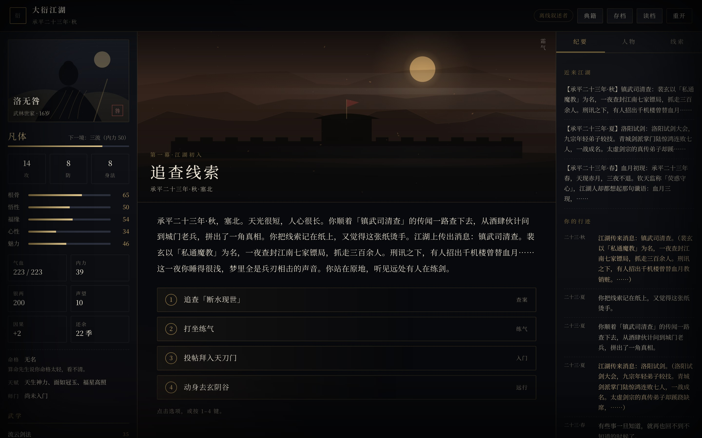
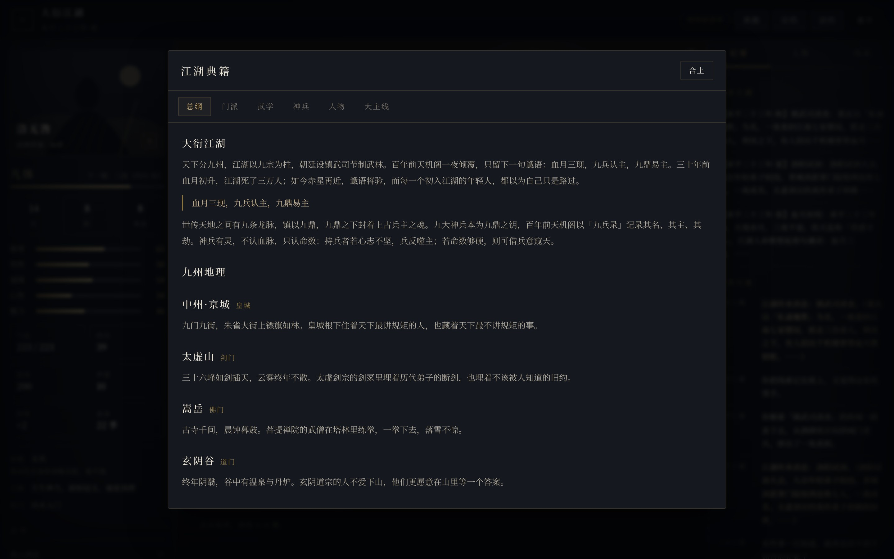
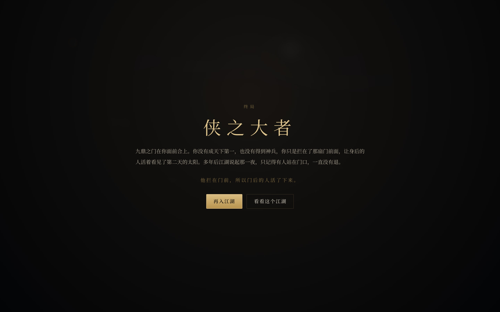

# 大衍江湖 · 一剑一生

> 血月三现，九兵认主，九鼎易主。
>
> 每一局都是新的人生；而九宗、武学、神兵、人物与那场大衍之局，早已写在设定里。

一个 **LLM 驱动的武侠人生模拟网页游戏**（AIPG）。玩家在承平二十三年春入江湖，用二十四个时节走完一段人生：
出身、天赋、命格、际遇与结局人人不同；但门派、武学、神兵、主要人物与主线年表是固定的，
由 `canon/*.json` 与 `docs/*.md` 锁死，LLM 只负责把引擎算出的结果写成武侠小说。



| 入江湖 | 江湖行迹 |
| --- | --- |
|  |  |

| 江湖典籍 | 终局 |
| --- | --- |
|  |  |

## 快速开始

```bash
cd wuxia-aipg
node server/index.js          # 打开 http://127.0.0.1:3100
```

零依赖、零构建：前端是原生 ES Module + Canvas 水墨场景，后端只用 Node 内置模块。
未配置大模型时，由内置的「离线叙述者」执笔，游戏照样能从头玩到尾。

接入任意 OpenAI 兼容接口（DeepSeek、通义、Kimi、vLLM、Ollama 的 `/v1` 均可）：

```bash
LLM_BASE_URL=https://api.deepseek.com/v1 \
LLM_API_KEY=sk-xxxx \
LLM_MODEL=deepseek-chat \
node server/index.js
```

| 环境变量 | 说明 | 默认 |
| --- | --- | --- |
| `LLM_BASE_URL` | Chat Completions 兼容地址（不含 `/chat/completions`） | `https://api.openai.com/v1` |
| `LLM_API_KEY` | 密钥；留空则使用离线叙述者 | 空 |
| `LLM_MODEL` | 模型名 | `gpt-4o-mini` |
| `LLM_TIMEOUT_MS` | 单次调用超时 | `45000` |
| `WUXIA_PORT` / `WUXIA_HOST` | 监听地址 | `3100` / `127.0.0.1` |
| `WUXIA_DATA_DIR` | 存档目录 | `./data` |

## 玩法

- **一回合 = 一个时节**，从承平二十三年春到承平二十八年冬，共 24 回合；人物寿命与结局在终局结算。
- 每回合从 3–4 个行动中选择：练气、练招、远行、访人、探秘、动手、疗伤、谋生、查案、突破、入门、问心。
- 属性：根骨、悟性、福缘、心性、魅力；境界从凡体到天人共八重，突破要看内力与心境。
- 江湖大事按固定年表发生（血月三现、试剑大会、镇武司清查、九兵现世、正魔大战、执剑人现身、九鼎开门），
  玩家不在场，事情也照常发生；在场则可以亲历、插手、留名，或死在其中。
- 结局共 8 种：问天、天下第一、侠之大者、魔道至尊、执棋人、归隐、身死道消、无名之墓。

## 固定设定与随机人生

| 固定（写在文档里） | 随机（每局重掷） |
| --- | --- |
| 12 个门派/势力的山门、掌门、绝学、立场与暗线 | 姓名、性别、相貌 |
| 33 门武学的品级、门槛、效果与来历 | 出身（12 种）、初始武学 |
| 9 柄神兵的主人、现世地、威能与认主条件 | 天赋（18 种中抽 2–3 个） |
| 17 位主要人物的身份、性情、战力与秘密 | 命格（8 种，影响际遇权重） |
| 5 幕 24 个主线事件的时间、地点与后果 | 五维属性、初始银两与所在地 |
| 8 种结局的判定条件 | 24 回合里遇见谁、学到什么、死在哪里 |

设定文档是**生成的**：`canon/*.json` 是唯一事实来源，`npm run docs` 生成 `docs/*.md`，
`npm run docs:check`（测试内自动执行）保证文档不会和代码里的设定漂移。

- [世界总纲](docs/00-世界总纲.md)
- [门派志](docs/01-门派志.md)
- [武学谱](docs/02-武学谱.md)
- [神兵录](docs/03-神兵录.md)
- [人物志](docs/04-人物志.md)
- [大主线](docs/05-大主线.md)
- [结局录](docs/06-结局录.md)
- [玩法与数值](docs/07-玩法与数值.md)
- [叙事契约与 LLM 接入](docs/08-叙事契约与LLM接入.md)

## LLM 如何被约束

LLM 不是游戏的主宰，只是执笔者：

1. 引擎先算出这一回合的**事实**（行动成败、数值变化、天下大事、在场人物），再交给叙述者；
2. 叙述者只能输出 `{"prose": "...", "options": [...]}`，选项的 id、数量、顺序与机制含义由引擎给定；
3. 设定守卫（`server/guard.js`）会检查：是否出现现代词汇、是否虚构了《武学》、是否提前泄露未解锁的秘密、
   叙述长度与选项格式是否合规；不合格就重试一次，再不合格就退回离线叙述者；
4. 因此断网、限流、模型胡写都不会毁掉这一局，也不会污染设定。

## 目录结构

```
wuxia-aipg/
├── canon/                # 固定设定（唯一事实来源）
│   ├── world.json        # 世界、地区、年表、规则
│   ├── sects.json        # 门派与势力
│   ├── arts.json         # 武学
│   ├── weapons.json      # 神兵
│   ├── characters.json   # 主要人物
│   ├── storyline.json    # 五幕主线与 24 个固定事件
│   ├── endings.json      # 结局与判定条件
│   └── lifegen.json      # 姓名、出身、天赋、命格（随机人生用）
├── docs/                 # 设定文档（由 canon 生成）+ 玩法/叙事说明 + 截图
├── server/
│   ├── canon.js          # 加载、索引、自检、对玩家隐藏暗线
│   ├── birth.js          # 随机人生
│   ├── mechanics.js      # 行动结算
│   ├── story.js          # 年表推进、主线事件、结局判定
│   ├── director.js       # 每回合的选项导演
│   ├── guard.js          # 设定守卫与提示词
│   ├── narrators/llm.js  # OpenAI 兼容叙述者
│   ├── narrators/offline.js # 离线叙述者
│   ├── engine.js         # 回合编排
│   ├── server.js         # HTTP API + 静态服务
│   └── store.js          # 内存对局 + JSON 存档
├── web/                  # 原生前端：水墨 Canvas、面板、典籍、存档
├── test/                 # node:test：设定、出生、引擎、守卫、服务端、文档一致性
└── scripts/              # 文档生成、通关模拟、截图
```

## 命令

```bash
npm start            # 启动
npm test             # 39 项测试：设定自检、确定性、主线、守卫、LLM 接入、API、文档一致性
npm run docs         # 由 canon 重新生成设定文档
npm run docs:check   # 校验文档与设定是否一致
npm run test:play    # 走完一局并打印人生年表（离线叙述者）
npm i                # 仅截图需要（devDependency: playwright）
npm run shot         # 抓取界面截图到 docs/screenshots/
```

## 技术要点

- **确定性**：所有随机都由种子派生（`seed + 回合 + 选项`），同一局可复现、可测试；存档就是一段 JSON。
- **设定守卫**：把「LLM 会不会写崩设定」变成可测试的断言，而不是祈祷。
- **离线可玩**：没有 API Key 也能完整通关；LLM 只是把同样的事实写得更漂亮。
- **零依赖**：Node 内置 HTTP、原生 Canvas 2D、CSS 变量与 ResizeObserver；没有构建步骤，没有 node_modules。
- **暗线隔离**：人物的 `secret`、门派的秘密只在设定文档与解锁后出现，提示词按 flag 过滤。

## 已知边界

- 单机单人，无账号；对局存在服务端内存，存档在 `data/saves/*.json`。
- 战斗是「战力 + 随机」的一次判定，不做逐招回合制。
- 目前的 LLM 接入是 Chat Completions 兼容协议；未做流式输出（前端用打字机效果模拟）。
- 浏览器端不依赖任何外部字体或 CDN；中文字体使用系统字体栈。
